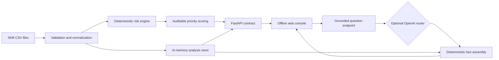

# MineShift Safety Console

Working web prototype for **HACK ALEM AI 2026 — AI Mine Safety Incident Prevention Assistant**.

MineShift processes the supplied shift CSV files during the demonstration, detects and prioritizes safety risks, separates observed evidence from interpretation, recommends the next supervisor action, and answers natural-language questions without inventing mine data.

## What the prototype does

- Uploads any available combination of `workers.csv`, `equipment.csv`, `environment.csv`, and `events.csv`.
- Isolates malformed rows so one bad record cannot crash an analysis.
- Calculates the current-shift overview from the dataset's latest timestamp, not the server clock.
- Detects severe and safety-critical event types, worker–moving-equipment conflicts, adverse environmental readings, abnormal statuses, and telemetry inconsistencies.
- Correlates three or more independent risk families into a compound zone escalation for coordinated investigation.
- Ranks every risk with an auditable 0–100 score, score components, and explicit priority reasons.
- Shows affected zone/entities, source rows, observed facts, interpretation, limitations, and recommended action.
- Supports priority and zone filtering, four interface languages, re-analysis, and empty/no-risk states.
- Answers top-risk, zone, entity, recent-change, overview, and evidence questions from the active analysis.
- Reports accepted/rejected record counts and localized row-level data-quality warnings.

## Architecture



The risk engine—not the language model—creates risks, scores, values, evidence, and actions. The optional OpenAI-compatible Chat Completions call only classifies question intent and extracts identifiers already present in the analysis. The backend validates that JSON route, constructs the final answer, and verifies every referenced evidence ID. If AI configuration is absent, times out, or fails, the same endpoint automatically uses its deterministic router.

## Repository layout

| Path | Purpose |
| --- | --- |
| `index.html`, `app.js`, `styles.css` | Dependency-free runtime frontend |
| `backend/app/services/ingestion.py` | CSV validation and normalization |
| `backend/app/services/risk_engine.py` | Detection and transparent scoring |
| `backend/app/services/qa.py` | Grounded question routing and answers |
| `backend/app/main.py` | FastAPI endpoints and CORS |
| `sample_data/mock_shift/` | Synthetic demo data with valid and malformed rows |
| `docs/frontend-contract.json` | Stable frontend/API contract fixture |
| `run.ps1` | One-command local demo launcher |
| `configure-ai.ps1` | OpenAI or third-party relay/model selector |

## Setup

Requirements: Python 3.11+ and PowerShell on Windows. The runtime frontend has no CDN or Node.js dependency.

```powershell
git clone https://github.com/elika-88/mining-.git
cd mining-
python -m venv backend/.venv
backend\.venv\Scripts\python.exe -m pip install -r backend\requirements.txt
Copy-Item backend\.env.example backend\.env
```

AI configuration is optional. The easiest setup—including third-party OpenAI-compatible relays—is:

```powershell
.\configure-ai.ps1
```

The script securely asks for the provider base URL and key, calls `<base_url>/models`, lets you select a returned model, and writes the choice to the Git-ignored `backend/.env`. Use a base URL ending in `/v1`, for example `https://api.openai.com/v1` or the relay's documented OpenAI-compatible endpoint.

You can also pre-fill the URL or model while keeping the key out of shell history:

```powershell
.\configure-ai.ps1 -BaseUrl "https://relay.example/v1" -Model "provider-model-id"
```

Manual configuration uses these values in `backend/.env`:

```env
OPENAI_API_KEY=your-key
AI_MODEL=your-available-model-id
AI_BASE_URL=https://api.openai.com/v1
```

`AI_API_KEY` is accepted instead of `OPENAI_API_KEY`. Never commit the `.env` file. The relay must provide compatible `/chat/completions`; model listing can be skipped by entering the model manually if `/models` is unavailable. Without AI values, the demonstrated Q&A remains available through `deterministic_fallback`.

## Run

Start both services with one command:

```powershell
.\run.ps1
```

Then open:

- Application: `http://127.0.0.1:5173`
- Swagger UI: `http://127.0.0.1:8000/docs`
- OpenAPI JSON: `http://127.0.0.1:8000/openapi.json`

If script execution is restricted, use two terminals:

```powershell
# Terminal 1
cd backend
.\.venv\Scripts\python.exe -m uvicorn app.main:app --reload
```

```powershell
# Terminal 2, from the repository root
.\backend\.venv\Scripts\python.exe -m http.server 5173 --bind 127.0.0.1
```

## Five-minute judging demo

1. Open `http://127.0.0.1:5173` and show the empty state.
2. Select the four files in `sample_data/mock_shift/` and click **Run analysis**.
3. Show active workers/equipment, shift events, and high-priority risk count.
4. Open the first CRITICAL risk and show its score, affected entities, observed rows, limitations, interpretation, and action.
5. Expand **Data quality** to show that malformed records were rejected without crashing the analysis.
6. Ask **Which risk requires immediate attention?**
7. Ask **What evidence supports this alert?** while the first alert is selected.
8. Show the returned evidence references and explain that the answer comes from the uploaded shift only.
9. Change a priority or zone filter.
10. Click **Run analysis** again to prove live reprocessing.

The bundled data is explicitly synthetic and is not organizer-provided mine data. Expected results are documented in `sample_data/mock_shift/README.md`.

## API

| Method | Endpoint | Purpose |
| --- | --- | --- |
| `GET` | `/api/health` | Service health |
| `GET` | `/api/config/risk-thresholds` | Active prototype thresholds |
| `GET` | `/api/config/ai` | Safe AI-routing status |
| `POST` | `/api/analyses` | Upload CSVs and run analysis; optional multipart `language` (`en`, `ru`, `kk`, `zh`) |
| `POST` | `/api/analyses/{analysis_id}/localize` | Rebuild the same analysis in another supported language without re-uploading CSVs |
| `GET` | `/api/analyses/{analysis_id}/overview` | Shift overview and processing quality |
| `GET` | `/api/analyses/{analysis_id}/risks` | Prioritized/filterable risks |
| `GET` | `/api/analyses/{analysis_id}/risks/{risk_id}` | Complete risk explanation |
| `GET` | `/api/analyses/{analysis_id}/evidence/{evidence_id}` | Source evidence detail |
| `POST` | `/api/analyses/{analysis_id}/questions` | Grounded natural-language answer; optional JSON `language` override |

Language changes preserve the analysis ID, risk IDs, source evidence, and data fingerprint. System-generated risk text, priority reasons, answer explanations, and data-quality diagnostics are localized. Uploaded IDs, zones, timestamps, statuses, descriptions, and sensor values remain unchanged as source-of-truth evidence; the UI shows original field keys followed by their translation.

Frontend integration:

```javascript
formData.append("language", currentLanguage);

const localized = await fetch(`/api/analyses/${currentAnalysis.analysis_id}/localize`, {
  method: "POST",
  headers: { "Content-Type": "application/json" },
  body: JSON.stringify({ language: currentLanguage })
}).then((response) => response.json());

const questionPayload = { question, language: currentLanguage };
```

## Grounding and reliability

- Every observed fact carries resolvable evidence IDs and source-file/row provenance.
- Observed data is visually separated from interpretation and recommendation.
- Unknown analyses, risks, evidence, zones, and entities return explicit insufficient-data or not-found responses.
- Missing timestamps/zone IDs, invalid numerics, malformed rows, duplicates, empty files, no-risk datasets, and AI/API failures are covered by automated tests.
- Sensor and speed units are never invented because the challenge schema does not define them.
- Thresholds are configurable prototype policy, exposed at `/api/config/risk-thresholds`, and are not represented as statutory limits.

## Test

```powershell
cd backend
.\.venv\Scripts\python.exe -m pytest -q
```

The test suite covers contracts, malformed input, risk scoring, evidence resolution, question context, unsupported questions, four-language output, AI structured routing, and deterministic fallback behavior.

The committed `styles.css` is ready to run. Frontend contributors can regenerate it after changing utility classes with:

```powershell
npx --yes tailwindcss@3.4.17 -c tailwind.config.cjs -i frontend.css -o styles.css --minify
```

## Known limitations

- Analyses are stored in memory and are lost when the backend restarts.
- Zone co-presence does not prove physical proximity because the supplied schema has no coordinates or distance.
- Sensor and speed units must be confirmed with the actual site dataset.
- Prototype thresholds must be aligned with the mine operator's approved standards.
- The deterministic language router supports the challenge's common English, Chinese, Russian, and Kazakh question patterns; the optional model improves intent routing for other phrasing.
- Uploaded source values are intentionally not machine-translated because the provided CSV files remain the source of truth.
- The prototype does not include authentication, durable audit storage, or production deployment hardening.

## Data contract

The committed JSON fixture is available at `docs/frontend-contract.json`. The running API contract is authoritative and can be inspected at `/docs` or `/openapi.json`.
